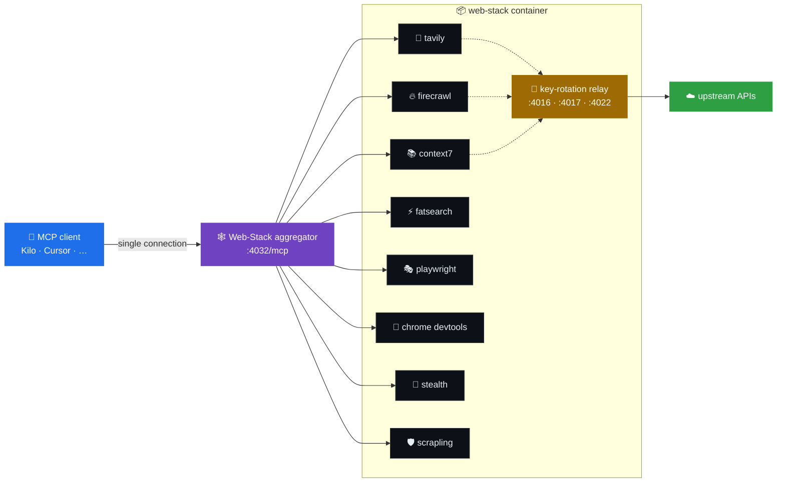

<div align="center">

# 🕸️ Web-Stack MCP

### ✨ **One MCP server. Eight web & browser MCPs. One container.** ✨

**127 tools · built-in API-key rotation · zero keys in the box**

[](#)
[](#-tool-coverage)
[](#-tool-coverage)
[](#-quick-start)
[](#-license)

<sub>Point your client at <b>one</b> endpoint — <code>http://127.0.0.1:4032/mcp</code> — and get everything.</sub>

</div>

---

## 🚀 What is this?

```text
┌────────────────────────────────────────────────────────────────────────┐
│   Instead of wiring EIGHT MCP servers into your client…                │
│   eight entries · eight ports · eight credential sets · eight failures │
│                                                                        │
│   Connect ONE.  🕸️ Web-Stack merges them all behind a single endpoint  │
└────────────────────────────────────────────────────────────────────────┘
```

The container runs every upstream on `127.0.0.1`, the **aggregator** re-exposes
their merged tools, and each call is transparently routed to the right server.

Tavily, Firecrawl and Context7 **rotate API keys automatically** through an
in-container relay: hold a *pool* of keys, and on `401 / 403 / 429` it slides to
the next one — callers never see a rate limit and **never hold a key**. 🔑

---

## 🧭 Architecture



---

## 🧰 Tool coverage — `127 tools`

| | Upstream | | Adds | Tools |
|---|---|---|---|---|
| 🔎 | **tavily** | search & research | web search · research · crawl · map · extract | `5` |
| 🔥 | **firecrawl** | scraping | scrape · crawl · search · agent · monitors · data providers | `34` |
| 📚 | **context7** | docs | versioned API / library documentation | `2` |
| ⚡ | **fatsearch** | free reader | URL / PDF → compact markdown | `1` |
| 🎭 | **playwright** | browser | headless Chromium automation + a11y snapshots | `25` |
| 🧭 | **chrome** | devtools | traces · network · CSS · Lighthouse · heap · screencast | `33` |
| 🥷 | **stealth** | anti-bot | undetectable (nodriver) browser | `21` |
| 🛡️ | **scrapling** | fingerprints | TLS/JA3 + HTTP/3 impersonation · session state | `17` |
| 🧩 | **local** | helpers | `web_stack_status` · `web_stack_rotation` · `web_stack_refresh` | `3` |

> 💡 Choose exactly what's exposed by editing `config/web-stack.config.example.json`
> (`include` / `exclude` / `prefix` / `enabled` per upstream), then restart.

---

## ⚡ Quick start

```bash
# 1 · clone
git clone https://github.com/Akshat-530/web-stack-mcp.git
cd web-stack-mcp

# 2 · keys  (never committed — .env is git-ignored)
cp .env.example .env
$EDITOR .env

# 3 · build & run
docker build -t web-stack:allinone .
docker run -d --name web-stack \
  -p 127.0.0.1:4032:4032 \
  --env-file .env \
  web-stack:allinone
```

Or use the published image:

```bash
docker compose -f docker-compose.example.yml up -d
```

Then connect your MCP client ➜ **`http://127.0.0.1:4032/mcp`** 🎉

---

## 🔑 Configuration (`.env`)

```dotenv
# ── API key pools — comma-separated, rotated automatically ──
TAVILY_API_KEYS=key1,key2
FIRECRAWL_API_KEYS=key1,key2
CONTEXT7_API_KEYS=key1,key2

# ── Auth tokens for the browser upstreams ──
STEALTH_BROWSER_MCP_AUTH_TOKEN=change-me
SCRAPLING_MCP_AUTH_TOKEN=change-me
```

> 🛑 **No keys ever touch the repo, the image or the config.** They live in `.env`
> only and are injected at runtime.

---

## 🔌 Ports

> Only **`127.0.0.1:4032`** is published. Everything else is internal.

| Service | 🔒 internal | | Service | 🔒 internal |
|---|---|---|---|---|
| 🕸️ aggregator | `4032` | | 🔥 firecrawl | `4008` |
| 🔎 tavily relay | `4016` | | 🧭 chrome | `4003` |
| 🔥 firecrawl relay | `4017` | | 🥷 stealth | `4007` |
| 📚 context7 relay | `4022` | | 📚 context7 | `4023` |
| 🎭 playwright | `4002` | | ⚡ fatsearch | `4027` |
| 🛡️ scrapling | `4033` | | 🔎 tavily | `4009` |

---

## 🛠️ Operations

```bash
docker exec web-stack supervisorctl status   # ✅ every upstream + relay
docker logs -f web-stack                     # 📜 live logs
```

Every upstream is **supervised** — it auto-restarts if it crashes. 🩹

---

## 🧩 Local helper tools

| Tool | Purpose |
|---|---|
| `web_stack_status` | 🩺 per-upstream reachability + tool counts |
| `web_stack_rotation` | 🔑 relay health (key count, calls) — **never prints keys** |
| `web_stack_refresh` | 🔄 re-read config + re-fetch upstream tool lists |

---

## 🔒 Security

- 🚫 No API keys in the image, repo or config — runtime `.env` only.
- 📍 MCP endpoint published on loopback only by default.
- 🔁 Rotating upstreams reach the internet through the in-container relay.

---

## 📜 License

MIT — see [LICENSE](LICENSE).
Upstream MCP servers, the stealth browser and Scrapling keep their own licenses;
this project only orchestrates them.

<div align="center">
<sub>Built with 🕸️ by <a href="https://github.com/Akshat-530">Akshat-530</a></sub>
</div>
